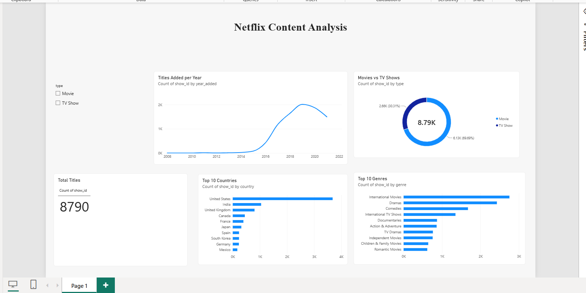

# Netflix Content Analysis

## About
I analysed the Netflix Movies and TV Shows dataset (from Kaggle) to find
what kind of content Netflix has. I used Python (pandas) to clean the data
and Power BI to build a dashboard.

## Tools Used
- Python (pandas, matplotlib) in Google Colab
- Power BI Desktop

## Steps
1. Loaded the data and checked for missing values
2. Cleaned the data: filled blank director, cast and country with "Unknown", removed rows with missing date, rating and duration, and created a year_added column
3. Split the genre and country columns so each value is counted separately
4. Built a Power BI dashboard with 5 visuals

## Key Findings
- About 70% of the titles are Movies and 30% are TV Shows
- The United States has the most titles, followed by India and the United Kingdom
- International Movies, Dramas and Comedies are the top genres
- Netflix added the most titles around 2019, and the number went down after that

## Dashboard

## Files
- netflix dashboard.pbix: Power BI file
- Netflix_Analysis.ipynb: Python cleaning and analysis
